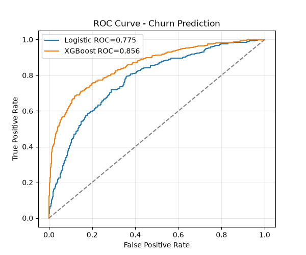

# Bank Customer Churn Prediction - 86.6% ROC-AUC
Predicted which 20% of bank customers will churn using XGBoost. Focus on actionanble segments , not just accuracy.

### Problem
Bank loses 20.4% customers yearly. Goal: Identify higher-risk customers before they leave to trigger retention.

### Results

|Model                 | ROU-AUC | Key Metric
|Logistic Regression   | 81.1%   | Baseline
|KNeighborsClassifier  | 83.5%
|DecisionTreeClssifier | 85.4%
|RandomForestClassifier| 86.5%

### Key Insights 
1. Riskiest Segment: Germany Female 37.5% churn
  - 195% more likely to churn than France Male (12.7%)
  - 2.9x lift - primary target fro retention campain

2. Gender Gap: Female churns 52% more
  - Female: 25.1% vs Male: 16.5% (8.6 difference)
  - Indicates product gap for female customers 

3. Age: Churned = 7.4 years older
  - Churned avg: 44.8 years vs stayed: 37.4 years
  - Risk jumps after 40

4. Activity: Inactive churn 54% more
  - Only 36% of churned were active vs 55% of retained
  - App activation = retention level

5. Balance Paradox: Richer customers leave
  - Churned balance: $91k vs Stayed: $72k (+25%)
  - Hight-value customers have more options

6. Product Stickiness:
   - 1 product = high churn, 2 products = sticky, 3-4 products = high churn

### Roc Curve

### Files 
- `notebook.ipynb` - Modeling
- `eda.ipynb` - EDA calculations
- `app.py` - Streamlit app
- `model.pkl` & `scaler.pkl` - Production artifacts

### Business Recommendation
Target Germany Female 40+ with 1 product and high balance - offer  2nd product bundle + personal banker to produce 37.5% churn to <20%.