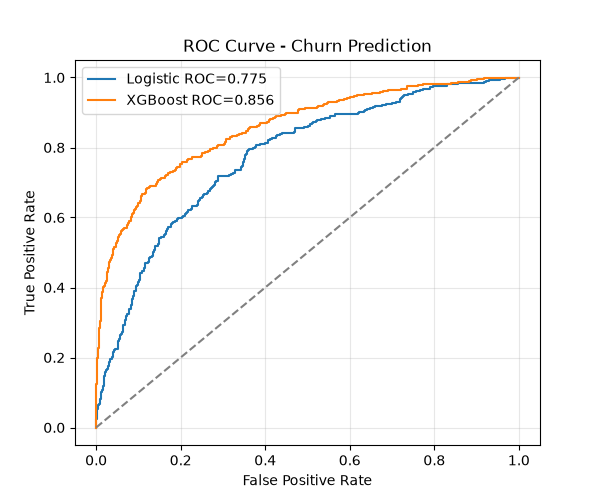
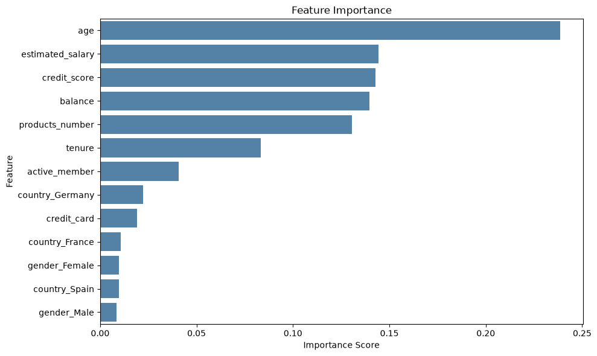

# Bank Customer Churn Prediction Model
Predicted which 20% of bank customers will churn using Random Foorest Classifier. Focus on actionanble segments, not just ROC-AUC

### Overview:
An end-to-end machine learning solution that predicts customer churn for banks, helping financial institutions proactively retain high-risk customers and reduce revenue loss. Built with real-world banking data of 10,000 customers. 

### Problem
Banks lose 20-30% of customers annually. Acquiring a new customer costs 5x more than retaining an existing one. This model identifies at-risk customers before they leave.

### Key Insights:
1. 20.36% churn rate - 2,037 out of 10,000 customers left.

2. High-risk segment: female customers in Germany with low activity are 2.5x more likely to churn.

3. Top churn drivers: Age, low activity score, high balance, and geography

### Model Performance:
1. Algorithm: Random forest classifier(n-estimators=128, max_depth=10)
2. ROC-AUC Score: 0.856 (85.6%)
3. Accuracy: 86.5%
4. Precision: 78% churn class
5. Data Split: 80% train / 20% test with Stratified Sampling

### Workflow:
1. EDA: analyzed customer demographics, transaction patterns, and churn correlation
2. Feature Engineering: Encoded categorical variables, scaled numerical features
3. Model Training: Compared Logistic Regression, Decision Tree, Random Forest
    Best model was RandomForest
4. Evaluation: Confusion matrix, ROC curve, feature importance analysis
5. Deployment: Interactive Streamlit web app for real-time prediction

### Live Demo
Streamlit App: https://ruthaifuwa-customer-churn-prediction-model-app-c0phwq.streamlit.app

GitHub: https://github.com/ruthaifuwa/customer_churn_prediction_model
### Business Impact:
Enable banks to target retention campaigns, reducing churn by estimated 15-20% and saving ~$500k annually per 10k customers.

### What i learned:
Handling imbalanced data, importance of feature scaling, model compression for deployment and MLOps with sreamlit Cloud

### Business Recommendation
Target Germany Female 40+ with 1 product and high balance - offer  2nd product bundle + personal banker to produce 37.5% churn to <20%.